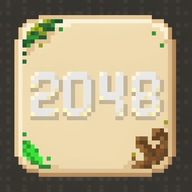
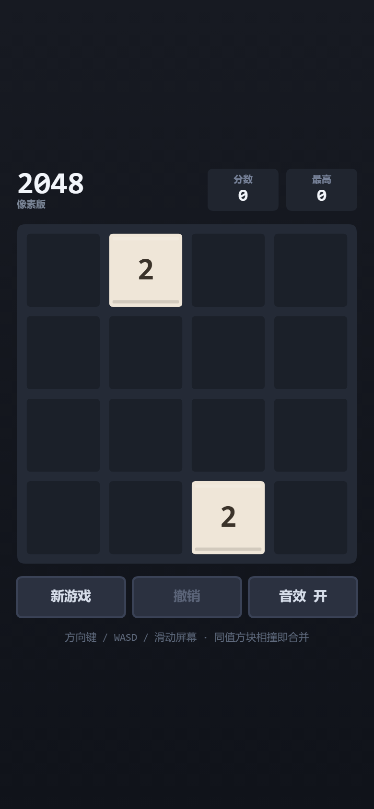

# 2048 像素版 · Pixel 2048

<p align="left">
  
</p>

一个**完全重写**的 2048 复刻：纯 Canvas 2D、零外部素材、零运行时依赖，
同一份代码可以跑在浏览器里，也可以打包成 **B站小游戏**。

> 玩法源自 [2048](https://github.com/gabrielecirulli/2048)（Gabriele Cirulli，MIT）。
> 本项目为独立实现，未复制其代码，也未使用任何第三方游戏（包括截图中的
> 「2048 开放趣味游戏」APK）的素材。详见 [NOTICE.md](NOTICE.md)。



## 特性

- **规则严谨**：合并顺序、单次合并、无变化不生成等边界均有单测覆盖（9 个用例）
- **多输入**：方向键 / WASD / 滑动 / 鼠标拖拽 / 画布按钮
- **有手感**：滑动 150ms 缓出、合并弹跳、新块缩放、吞并淡出
- **能续玩**：每次移动自动存档，关掉页面再打开就是原局面
- **可回退**：20 步撤销
- **零素材**：图形全代码绘制，音效全 WebAudio 合成 → 包体约 38 KB，无版权链风险
- **跨平台**：规则层不含 DOM，渲染层只用 Canvas，平台差异收敛在 `platform/` 与 `src/main.js`

## 快速开始

环境：Node.js ≥ 18（仅用于本地静态服务与测试，游戏本身无依赖）

```bash
npm start          # http://localhost:5173
npm test           # 运行规则单测
npm run build:bilibili   # 生成 dist/bilibili（小游戏工程）
```

也可以直接双击 `index.html` 打开，或任意静态服务器托管本目录。

## 操作

| 输入 | 行为 |
| --- | --- |
| `↑ ↓ ← →` / `W A S D` | 移动 |
| 滑动 / 拖拽 | 移动 |
| `R` | 新游戏 |
| `Z` / `U` | 撤销 |
| `M` | 音效开关 |

## 目录结构

```
index.html                  浏览器入口
src/
  core/game.js              规则引擎（无 DOM，可单测）
  core/storage.js           存档抽象（localStorage / 平台存储）
  render/renderer.js        Canvas 渲染、命中测试、动画
  app.js                    应用层：音效、按钮动作、存档联动
  main.js                   浏览器壳：指针、键盘、尺寸
  styles.css                页面外壳样式
platform/bilibili/
  bootstrap.js              小游戏壳：画布、尺寸、存储、触摸、启动埋点
  game.json                 小游戏配置（竖屏、无状态栏）
docs/
  GAMEPLAY.md               玩法 / 资源 / UI / 操作 / 存档梳理
  BILIBILI-PLATFORM.md      B站发布要求调研与适配说明
  RELEASE-CHECKLIST.md      上线前检查清单
  SUBMISSION-MATERIALS.md   提审材料包（名称/简介/测试说明/隐私说明/流程）
scripts/
  serve.mjs                 零依赖静态服务器
  build-minigame.mjs        生成小游戏工程
tests/game.test.mjs         规则单测
```

分层是刻意的：`core` 不认识 Canvas，`render` 不认识 DOM，
换平台只需要再加一个「壳」。

## 平台适配

目标是 **B站小游戏**（`miniapp.bilibili.com`）：

```bash
npm run build:bilibili
```

产物 `dist/bilibili/` 直接用哔哩哔哩开发者工具导入即可，包含：

- `game.js`：入口，按序 `require` 各模块
- `game.json`：竖屏、隐藏状态栏
- `platform/bootstrap.js`：取画布、适配存储、绑定触摸、首帧后调用 `bl.launchSuccess()`

包体约 38 KB（主包上限 4 MB），不发起网络请求，因此无需配置域名白名单。

完整调研（技术规格、必接能力、审核流程、资质材料、两条发布通道的差异）
见 [docs/BILIBILI-PLATFORM.md](docs/BILIBILI-PLATFORM.md)；
上线前逐项对照 [docs/RELEASE-CHECKLIST.md](docs/RELEASE-CHECKLIST.md)。

## 推送到 GitHub

仓库已在本地初始化并完成首次提交。若要发布到你自己的 GitHub：

```bash
# 1. 在 GitHub 新建空仓库（不要勾选 README / .gitignore）
# 2. 关联并推送
git remote add origin https://github.com/<你的用户名>/pixel-2048.git
git branch -M main
git push -u origin main
```

想让浏览器版直接在线试玩，可在仓库 **Settings → Pages** 里选择
`Deploy from a branch` → `main` → `/ (root)`，几分钟后即可通过
`https://<你的用户名>.github.io/pixel-2048/` 访问。

## 构建与发布流程一览

```
npm test                 →  规则回归
npm start                →  本地试玩
npm run build:bilibili   →  dist/bilibili
开发者工具导入 + 真机预览  →  上传开发版
补材料 + 提交审核         →  审核通过后手动「发布」
```

## 已知边界

- 未实现「侧边栏复访」「桌面快捷方式」等 B站专有能力：官方文档中接口签名随版本变动，
  为避免臆造调用，只在 `bootstrap.js` 留了接入位置，请在后台按当期文档补齐并真机验证。
- 小游戏壳未在真机上验证过（本机没有 B站开发者工具），逻辑与浏览器版共用，
  但触摸坐标、画布创建方式仍需你在开发者工具里过一遍。
- 撤销历史不跨会话保存（只存当前局面），避免存档膨胀。

## 许可

代码以 [MIT](LICENSE) 发布。玩法来源与第三方声明见 [NOTICE.md](NOTICE.md)。
平台发布所需的资质、备案与内容合规由发布者自行负责。
